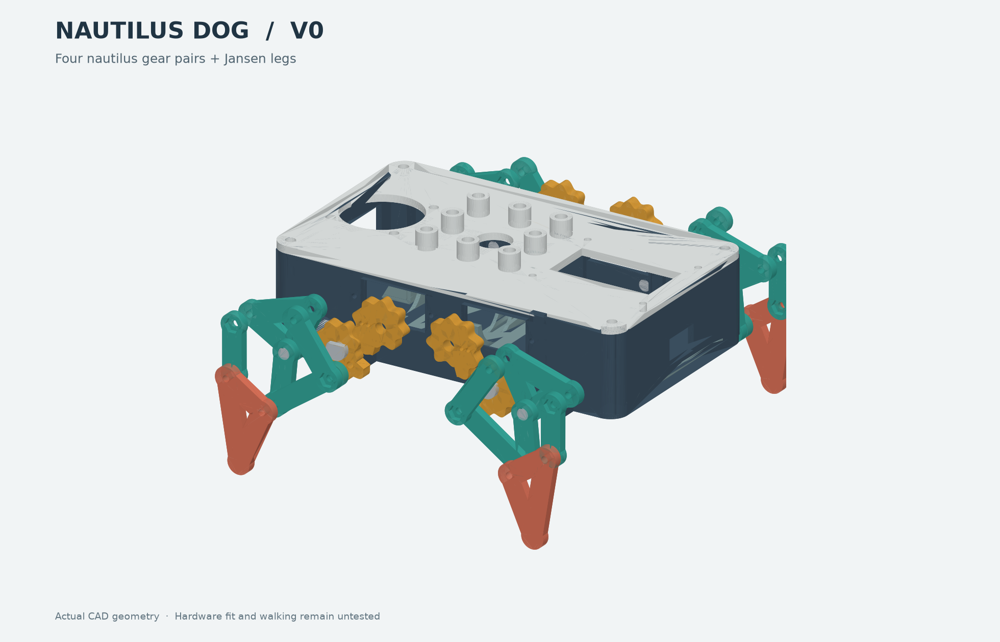
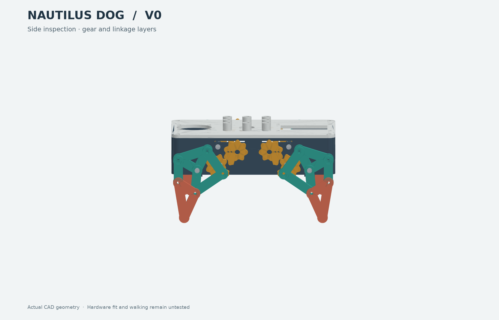

# Nautilus Dog V0

A phone-controlled, four-legged robot prototype with **one continuous-rotation micro servo per leg**. Each servo drives a pair of noncircular nautilus gears and a Jansen linkage to produce a walking foot path.



| Side view | Lid removed |
| --- | --- |
|  |  |

These images are renders of the project CAD, not photographs of a printed robot.

**Status: design and software prototype.** CAD checks and firmware builds have been reported, but no physical print, assembly, powered test, or successful walking test has been confirmed. The latest electrical component choices still need mechanical fit checks.

[Shopping list](#shopping-list) · [Assembly workflow](#assembly-workflow) · [Build from source](#build-from-source) · [Known limitations](#known-limitations-and-manual-checks)

## How it works

Each leg follows this chain:

```text
Continuous-rotation servo
        ↓
Nautilus gear pair — one input revolution per output revolution,
                    with a varying speed ratio during the cycle
        ↓
Crank → Jansen linkage → foot path with a near-flat stance section
```

The front legs reach forward and the rear legs reach backward, placing the feet near the four corners of the body. The linkages provide the foot motion mechanically; this is a single-actuator-per-leg mechanism.

Continuous-rotation servos control speed and direction, not absolute angle. Leg phase is calibrated by hand and estimated in firmware. There is no encoder feedback or active balance control.

| Item | Current design |
| --- | --- |
| Frame + lid | 126 × 75 × 31 mm |
| Expansion posts | Extend 6 mm above the lid |
| Swept CAD envelope | Approximately 152.1 × 144.6 × 69.6 mm, including moving legs |
| Actuators | 4 SG90/FS90R-class **continuous-rotation** micro servos |
| Controller | ESP32-C3 SuperMini |
| Display | 1.54-inch, 128 × 64 OLED, I2C variant |
| Battery / motor supply | 2S 18650 pack with charging/protection modules; regulated 5 V |
| Assembly | Hand-wired electronics on perfboard; printed structure and M2 linkage joints |

See the [original brief](prompts/original.md), [reference assets](prompts/assets/REFERENCES.md), and [mechanical changes from the draft](case/DEVIATIONS.md).

## Phone control

The firmware creates a local Wi-Fi access point and serves the controller at **http://192.168.4.1**. A cloud service or dedicated phone app is not required.

- On-screen joystick and eight direction buttons: forward/backward, pivots, and forward/backward arcs. Release the joystick or a held direction button to stop.
- Adjustable speed and trot/walk gait selection.
- One driving phone at a time, with a take-control action.
- OLED Wi-Fi information/QR codes, facial expressions, and an estimated battery percentage.
- Captive-portal support to help phones open the controller. If it does not appear, open the address above manually.
- A **Love** command: heart eyes and, from standstill, a programmed sequence of six left/right sways using short alternating pivots. The physical result is untested.
- A drive-command timeout and low-battery stop. Calibration actions have separate behavior; keep the feet clear during calibration.

The diagonal controls describe curved paths, not sideways walking. Calibration at **http://192.168.4.1/cal** sets neutral trim, direction, seconds per revolution, and phase zero, then saves them to NVS. Recalibrate if legs move while powered off or phase drifts.

Details: [firmware guide](firmware/README.md), [wiring](firmware/WIRING.md), and [configuration constants](firmware/include/config.h).

## Shopping list

Quantities below are for **one robot**, before optional spares. They follow [parts.json](parts.json), [the hardware definitions](case/hardware.json), and [the wiring plan](engineering/harness.md). Module dimensions and supplied servo hardware still need measurement.

The original builder already owns **8 continuous-rotation servos**: use 4 and keep 4 as spares. New builders need 4. Buy a few spare small fasteners if ordering individual sizes.

### Electronics and power

| Item | Quantity | What to buy / check |
| --- | --- | --- |
| Continuous-rotation micro servo | 4 | SG90/FS90R-class size, explicitly sold as continuous rotation. A standard 180° SG90 is unsuitable. [FS90R reference](https://www.pololu.com/product/2820); verify the actual body, horn, spline, and mounting holes with the test coupon. |
| ESP32-C3 SuperMini | 1 | An extra board is optional. Match the actual pin labels and dimensions to [pinout.md](engineering/pinout.md); ESP32-C3 boards are not all interchangeable. |
| 1.54-inch OLED | 1 | 128 × 64, SSD1309-class, **4-pin I2C configuration**. Check module size, hole pattern, pin order, voltage, and controller selection. Some boards ship in SPI mode. |
| 5 V buck-boost regulator | 1 | Current reference: [Pololu S13V30F5](https://www.pololu.com/product/4082). Approximately 22.9 × 22.9 mm; **does not fit the existing 22 × 17 mm holder**. Output capability depends on input voltage and temperature; verify it under the real load. |
| USB-C 2S Li-ion charger, CHG1a | 1 | 8.4 V charge target, with documented cell balancing and the required midpoint connection. **Exact module and fit are not validated**; verify its documentation and dimensions before purchasing. A 1S charger is unsuitable. |
| 2S protection board, CHG1b | 1 | Current reference: HX-2S-JH20-class board with B+/BM/B−/P+/P− connections. Confirm the actual board's continuous-current rating, pinout, and compatibility with the charger; the current design calls for at least 5 A continuous discharge. |
| Matched 18650 Li-ion cells | 2 | Same model/batch, 65 mm long, with a documented continuous-discharge rating of at least 5 A per cell. The cradle assumes cells without individual protection PCBs; **external 2S protection is required**. Longer protected cells may not fit. |
| Resettable fuse / PTC | 1 | Current wiring plan calls for a roughly 4 A hold-current class part; check temperature derating and the final power design. |
| Power switch | 1 | Nominal 7 mm mounting hole and at least 3 A DC rating; verify the actual switch and contact arrangement. |
| Fan | 1 | 30 × 30 × 10 mm, 5 V, two wires; four mounting holes on a 23 mm square. |
| Perfboard | 1 | 2.54 mm pitch, cut to approximately 22 × 52 mm; match the four mounting holes and the wiring diagram. |
| USB-C data cable | 1 | For firmware upload; a charge-only cable is insufficient. |

**The charger/protection combination is still a prototype selection, not a validated battery assembly.** Confirm the exact modules and charging/protection behavior before connecting cells. For battery tabs, use a suitable spot-welding service rather than soldering directly to cells.

The KiCad carrier is the schematic/layout reference. The intended physical build is hand-wired; do not order a PCB as a substitute for the separate servo power wiring.

### Small electrical parts and wiring

| Item | Quantity | Purpose / specification |
| --- | --- | --- |
| 4.7 kΩ resistor | 2 | I2C pull-ups; through-hole 1/4 W parts for perfboard |
| 100 kΩ resistor | 1 | Battery divider |
| 33 kΩ resistor | 1 | Battery divider |
| 10 kΩ resistor | 4 | Servo signal pull-downs |
| 100 nF ceramic capacitor | 3 | Decoupling/filtering |
| 1000 µF electrolytic capacitor | 1 | At least 10 V; nominal body 8 × 11.5 mm. Current reference: Rubycon 10PX1000MEFC8X11.5; verify size and lead pitch. |
| 100–220 µF electrolytic capacitor | 1 optional | At least 10 V; reserve for MCU supply troubleshooting described in [bring-up](engineering/bringup.md). |
| Schottky diode | 1 | 1N5817 through-hole substitute or SS14 as documented in [parts.json](parts.json) |
| 2.54 mm male header, 40-pin strip | 2 | Cut for the module/header connections |
| Single-pin female crimp housings + contacts | 10 | Four servo signal connections plus spares |
| Low-profile 2-, 4-, and 6-pin female housings + contacts | 2 of each | Power/fan, OLED, and expansion connections; check clearance below the OLED |
| AWG24 stranded wire | About 2 m each of red, black, and orange | Power, ground, and signals; follow the branch lengths in the wiring plan |
| Heat-shrink tubing | 1 assortment | Insulate joints and wire splices |
| Nickel strip / prepared cell tabs | About 20 cm, as needed | Have the battery connections prepared with suitable equipment |
| Cable ties | A small pack | Battery retention and strain relief |

**Servo power wiring:** servo red/brown leads go to the +5 V/GND splice at the regulator output. Only the signal lead goes to **pin 1 of J3–J6**; leave pins 2–3 unused. Keep a common ground. Follow [the full wiring table](engineering/harness.md), not wire colors alone.

### Mechanical parts and consumables

| Item | Quantity | Used for |
| --- | --- | --- |
| PETG filament, 1.75 mm | 1 spool | Current assumed print profile; a 1 kg spool is a purchase unit, not an estimate of material used |
| M2 × 18 mm screw | 4 | Leg joint C |
| M2 × 14 mm screw | 12 | Leg joints D, E, and F |
| M2 × 8 mm screw | 4 | Leg joint G |
| M2 × 10 mm screw | 4 | OLED mounting |
| M2 hex nut | 28 | 20 for the legs + 8 for the OLED, including its nut spacers |
| M2 self-tapping screw | 4 | Perfboard/carrier holder; current shopping reference is M2 × 5 mm. Check pilot depth before fitting; original assembly notes also mention approximately 4 mm. |
| M3 × 10 mm self-tapping screw, pan head | 4 | Lid |
| M3 × 4 mm heat-set insert, approximately 4.6 mm OD | 8 | Expansion deck; confirm fit with the lid coupon |
| M3 × 16 mm screw | 4 | Fan |
| M3 hex nut | 4 | Fan |
| Supplied servo/horn screws and horns | 1 set per servo | Reuse the hardware supplied with the servos; dimensions are unmeasured |
| CA/superglue | 1 small bottle | Holders and the specified fixed/locked interfaces; keep it out of rotating bores |
| Foam double-sided tape | 1 roll | Electronic module mounting; final placement still needs checking |

Printed pins, gears, links, holders, frame, and lid come from the CAD; they are not additional purchased shafts or bearings. The original layout contains **47 production pieces** plus **5 separate test coupons**. The newer regulator installation omits the old buck holder; the CAD/plate set has not yet been reconciled with that change.

Useful tools: a 3D printer, soldering iron and solder/flux, multimeter, calipers, wire stripper, crimping tool, small screwdrivers/hex keys, heat-set insert tool, and a current-limited bench supply for bring-up.

## Assembly workflow

1. **Print the test coupons first.** Check the servo seat, module openings, gear mesh, linkage joint, and lid against real purchased parts. Resolve fit problems before printing the full set.
2. **Print the production parts** using the actual printer/material profile. The existing profile assumes a Bambu A1, 0.4 mm nozzle, PETG, and 0.20 mm layers; this is not a confirmed profile for every printer.
3. **Assemble the mechanism** using [the case guide](case/README.md) and [hardware definitions](case/hardware.json). Check free rotation through a full cycle.
4. **Fit the electronics and wire the robot** using [the harness table](engineering/harness.md). Check module clearances with the lid in place.
5. **Follow the staged bring-up procedure** in [bringup.md](engineering/bringup.md), starting without the battery or servos.
6. **Upload and calibrate the firmware** using [the firmware guide](firmware/README.md). Lift the feet clear for calibration, then perform a controlled first walking test.

[PRINT.md](PRINT.md) contains the existing print/assembly checklist, and [BUY.md](BUY.md) contains the earlier shopping checklist. Some supporting documents and the original brief are in Vietnamese; the consolidated shopping list above is in English.

## Known limitations and manual checks

- **Latest power modules need a mechanical update.** The Pololu regulator does not fit the original buck holder. The documented temporary approach is foam-tape mounting, but final placement, electrical isolation, and lid clearance need checking. The added protection board's proposed location above the cells has not been validated in CAD.
- **Confirm every bought-part envelope.** Servo bodies/horns, module sizes, fan, cell tabs, and factory screws have not been measured. Use the test coupons. The cradle assumes 65 mm cells.
- **Keep the Q pivot free.** Insert the Q pin from inside the body and glue it into the rocker only; it must rotate in the frame bore. Check both the servo-seat and leg-joint coupons for the pin interfaces. See [deviation D8](case/DEVIATIONS.md#d8-q-pin-turns-with-the-rocker-inserted-from-inside-the-box).
- **Check connector and screw height.** Wires under the OLED must leave sideways; the selected maximum is 11.5 mm above the header base. The ESP32 seating target is 2.5 mm, not a tall female socket. Verify carrier screw penetration and real nut/insert fits.
- **Inspect the printed frame and cable routes.** Small corner-boss protrusions may need deburring. Keep wiring out of moving links and away from the OLED underside; do not assume the route over the cells is clear.
- **Calibrate and inspect the display on hardware.** Phase tracking is open-loop. The Wi-Fi/URL QR sequence, battery text, and calibration behavior still need a real device check. Calibration spin has its own five-second limit; it is not equivalent to the normal driving timeout.
- **Generated viewers and printer handoff remain unconfirmed.** Earlier automated UI checks lacked usable WebGL/window access. The print-team handoff also failed despite a parsed 3MF; no print job was sent. This is separate from generating files for manual inspection.
- **Electrical estimates require measurements.** The current budget assumes about 2.8 A at 5 V; actual servo stall current and regulator thermal performance may exceed that model. Battery percentage is an estimate, not a fuel-gauge measurement.

These checks retain the practical findings from the original independent reviews. A passed CAD, ERC/DRC, or compile check does not establish physical fit, battery behavior, or walking performance.

## Build from source

The repository contains authored sources and the selected README images. **STEP/STL/3MF, generated reports, viewer HTML, and firmware binaries are not committed.** The output paths listed below appear only after building; they are not prebuilt GitHub downloads.

The current build pipeline targets **macOS**. It expects:

| Stage | Tools |
| --- | --- |
| Board | Autonomous Circuit's KiCad toolchain, Python 3.10+ (3.12 recommended), KiCad 10 CLI and matching pcbnew runtime, zsh, rsync |
| Case | Board tools plus CadQuery, NumPy, Matplotlib, VTK, Node.js, and Bambu Studio 2.7 at the path expected by the scripts |
| Firmware | Arduino CLI, ESP32 core 2.0.14, U8g2 and WebSockets libraries, Node.js, and a C++ compiler; QR sources are included |

Install/configure the toolchain from [Autonomous Circuit](https://github.com/autonomous-ai/autonomous-circuit/tree/main/harness/kicad) first. A Harness app session can supply the environment variables, but the app itself is not required: the Python wrapper scripts in that repository can also be used from a terminal.

```sh
git clone https://github.com/triluongmh-byte/dog-nautilus.git
cd dog-nautilus

# Replace this with your actual Autonomous Circuit checkout.
export CIRCUIT_REPO="/absolute/path/to/autonomous-circuit"
export KICAD_HARNESS_PYTHON="$CIRCUIT_REPO/harness/kicad/toolchain/python"
export KICAD_CASE_PYTHON="$CIRCUIT_REPO/harness/kicad/toolchain/case-python"

# Choose only the stage(s) you need.
./build.sh board
./build.sh case
```

For firmware, point Arduino CLI at the directories where **your** ESP32 core and libraries are installed:

```sh
export ARDUINO_DIRECTORIES_DATA="/absolute/path/to/arduino-data"
export ARDUINO_DIRECTORIES_USER="/absolute/path/to/arduino-sketchbook"
./build.sh firmware
```

Run `./build.sh` without stage names to build everything. The case stage builds missing board inputs first. The pipeline reuses the existing PCB copper; it does not reroute the board. Missing dependencies or failed checks stop the build, and the script does not install dependencies, flash a device, operate a printer, or place orders.

| Generated output | Local path after building |
| --- | --- |
| STEP/STL files and parts manifest | `case/out/` |
| Full production print project | `case/print/production.3mf` |
| Separate test-coupon print project | `case/print/test-only.3mf` |
| Assembly overview | `case/overview.html` |
| Native board preview/report files | `boards/main.board.json`, `boards/main_review/` |
| Mechanical verification reports | `case/reports/` |
| Firmware binary | `build/firmware/arduino-build/sketch.ino.bin` |
| Rebuild summary | `build/release-proof.json` |

The older mechanical sweep covered 72 poses using the earlier component envelopes. The November 16 firmware/electrical revision reports a successful Arduino CLI build and native board checks, while explicitly leaving the case unchanged. Regenerate and read the relevant reports for the revision you intend to build; do not combine an old mechanical pass with new module dimensions.

## Repository map

| Path | Contents |
| --- | --- |
| [case/](case/) and [tools/case/](tools/case/) | Parametric CAD, linkage geometry, checks, assembly and print tooling |
| [firmware/](firmware/) | ESP32-C3 sources, web controller, display and calibration |
| [design/](design/) | KiCad schematic/layout and local libraries |
| [engineering/](engineering/) | Wiring, power, protection, source evidence and bring-up |
| [parts.json](parts.json) and [case/hardware.json](case/hardware.json) | Electrical reference parts and mechanical hardware |
| [PILOT_CONTRACT.json](PILOT_CONTRACT.json) | Original sealed design inputs |
| [prompts/](prompts/) | Original brief, current summary and reference assets |
| [case/PRINTED-INVENTORY.md](case/PRINTED-INVENTORY.md) | Confirmed physical print inventory |

When contributing, describe the source revision, actual parts/printer/material, measurements, and checks performed. Keep generated CAD, slicer projects, reports, and binaries out of source commits. Report real print/fit/walking results separately from software checks.
