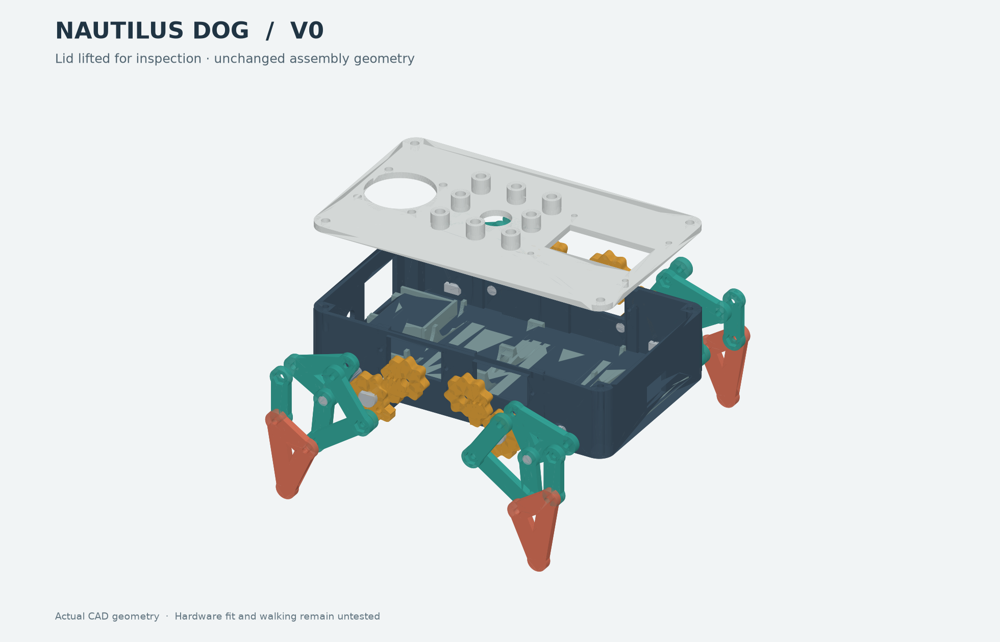

# Robot Chó Nautilus V0


| Nhìn bên hông | Tách nắp để quan sát |
|---|---|
|  |  |

Ảnh kết xuất từ đúng tệp CAD của dự án, chưa phải robot đã in/lắp. Tạo lại bằng `tools/render_readme.py` sau khi dựng CAD.

Bộ thiết kế ngày 2026-11-12: robot bốn chân, dùng 4 trong số 8 servo quay liên tục người dùng có. Mỗi servo kéo cặp bánh răng nautilus và chân Jansen. Điện lắp dây tay, ESP32-C3 SuperMini điều khiển qua điện thoại. KiCad là bản ghi sơ đồ/ERC, không dùng để đặt hàng.

Khung+nắp giữ 126 × 75 × 31 mm; trụ mở rộng nhô thêm 6 mm. Bao quỹ đạo chân CAD khoảng 152,1 × 144,6 × 69,6 mm, gồm chân vươn trước/sau trong cả chu kỳ. Bản nháp chưa được coi là đã in/thử. [Đề bài](prompts/original.md), [tham chiếu](prompts/assets/REFERENCES.md), [thay đổi và lý do](case/DEVIATIONS.md).

Các tệp bàn giao:

- [Hướng dẫn lắp và bản vẽ](case/README.md), [vít/tán và trục](case/hardware.json), [overview](case/overview.html).
- [3MF đủ bộ](case/print/production.3mf): 47 chi tiết trên 5 plate. [3MF TEST ONLY](case/print/test-only.3mf): 5 mẫu riêng gồm ổ servo, gá module/cửa mở, cặp bánh răng, khớp chân và nắp. [Báo cáo plate](case/print/production-check.json).
- [Nguồn CAD](case/build.py), [manifest STEP/STL](case/out/parts.json). Vách trên cửa servo tăng lên 2,1 mm; trụ ngang thay bằng bệ có lỗ và trục rời. Bán kính bánh răng và lớp thanh chân đổi để tránh cấn nhau.
- [Firmware/cách biên dịch](firmware/README.md), [đấu dây](firmware/WIRING.md), [sơ đồ KiCad](design/main.kicad_sch), [bảng dây module](engineering/harness.md).

Firmware có SoftAP, QR OLED, mặt cười, % pin ước lượng, 8 hướng đi và dừng, tốc độ, trot, canh pha từng chân và lưu hiệu chỉnh. Kiểm tra độc lập đã biên dịch bằng arduino-cli cho ESP32-C3, kiểm tra logic và JavaScript. PlatformIO chưa được chạy. Pha và tốc độ vẫn là ước lượng sau khi canh bằng tay; servo không có phản hồi góc.

Trạng thái kiểm tra:

- Bản sửa 2026-11-16 (chỉ board/tài liệu, copper giữ nguyên): native ERC/DRC/parity 0 finding (70 chân = 70 pad), manufacturing `prototypeReady: true` với hash mới, sidecar còn **1 cảnh báo** `power_entry_narrow` (đoạn +5V 0,3–0,4 mm, chỉ còn tải ≤1 A). [Báo cáo native](build/board-validation.json). Dòng tóm tắt "firmware not written yet" trong `.harness/verdict.json` do harness sinh, đã cũ: firmware đã có và đã biên dịch ở lượt trước.
- **Nguồn servo đi dây riêng:** dây đỏ/nâu của servo nối thẳng vào điểm nối ở đầu ra mạch hạ áp (AWG24, ≤0,3 m). Chỉ dây cam cắm vào chân 1 của J3–J6. Ngân sách điện: xấu nhất 2,80 A ở 5 V, 2,65 A khi pin 6,0 V ([power.md](engineering/power.md), [bảng dây](engineering/harness.md)).
- **Bắt đầu làm thật:** [BUY.md](BUY.md) là danh sách mua, [PRINT.md](PRINT.md) là thứ tự in và ráp.
- Mạch hạ áp: Pololu S13V30F5, 22,9×22,9 mm. Khối này **không vừa khay in sẵn**, tạm dán băng xốp xuống sàn.
- Mạch sạc là 2 module: CHG1a sạc USB-C có cân bằng cell, CHG1b là board bảo vệ HX-2S-JH20 10 A. Cầu chì PTC giữ khoảng 4 A. Đo áp ra của mạch sạc phải đúng 8,4 V thì mới lắp pin. Bằng chứng: [sources.md](engineering/sources.md), [DEVIATIONS](engineering/DEVIATIONS.md).
- Lắp thật trên tấm đục lỗ với linh kiện chân cắm, cùng giá trị như board KiCad. Board KiCad chỉ để ghi sơ đồ, không đặt hàng.
- **Lái như xe điều khiển từ xa:** con chó tự phát Wi-Fi, điện thoại vào Wi-Fi đó là trang lái tự bật lên. Nếu không tự bật, quét mã QR thứ hai trên OLED.
  - Kéo cần gạt ảo để đi, buông tay là dừng.
  - 8 nút hướng chạy kiểu giữ là đi, buông là dừng.
  - Nút **❤ Love**: con chó đang đứng yên sẽ lắc thân trái-phải 6 lần (khoảng 3 giây), màn OLED hiện mắt trái tim.
  - Mỗi lúc chỉ một điện thoại lái. Mất sóng 1 giây thì con chó tự dừng.
  - Mẹo giữ kết nối Wi-Fi nằm trong [firmware/README.md](firmware/README.md).
  - Đã biên dịch bằng arduino-cli, test logic và JavaScript đạt. Chưa nạp vào con chó, chưa chạy motor.
- Vỏ **không dựng lại** được trên máy này vì thiếu CadQuery/`KICAD_CASE_PYTHON`. Báo cáo vỏ bên dưới là của lần dựng trước.
- Khung, quét 72 tư thế, khớp, nắp và xuất in đã đạt trên tệp hiện tại: [tổng](case/reports/verification.json), [chuyển động](case/reports/moving-motion.json), [khớp](case/reports/joints.json), [xuất in](case/reports/print-check.json). Đây là kiểm tra CAD, chưa chứng minh chịu tải, ăn khớp thật hoặc đi bộ trên bàn.
- `verify stale` không liệt kê nguồn mới hơn bản xuất. Tuy vậy [báo cáo manufacturing](build/board-validation.json) ở bản bàn giao ban đầu có 3 lỗi hash bằng chứng cũ. Pipeline `build.sh` tính lại các hash từ nguồn hiện tại và yêu cầu native/manufacturing đều đạt; kết quả sau dựng nằm trong báo cáo này. Còn cảnh báo đường nguồn hẹp; servo thật cấp nguồn bằng dây theo hướng dẫn. Không coi gói PCB là sẵn sàng đặt hàng.
- PrintTeam thất bại cả lần đầu và lần thử lại: `ValueError: Print request needs verified plate and parts`. Chính bộ đọc của harness nhận đủ 47 chi tiết/5 plate, SHA-256 3MF `c332e63f751997e25e93579f50dcc6352bf9476614292510e67d6800657f9436`. Bộ lập kế hoạch trả plate 0 và danh sách chi tiết rỗng. Đội harness cần sửa bước điều phối; không có lệnh in nào được gửi.
- Overview đã tạo từ 8 bước lắp. Headless Chrome không có WebGL nên chỉ chip bước/thẻ vít được kiểm tra hiển thị. Công cụ UI trả `cgWindowNotFound` cho Harness, Chrome và Bambu Studio: chưa xác nhận trực tiếp điều khiển 3D hoặc mở 3MF bằng GUI. Pipeline `build.sh` nối lại trường `overview` trong manifest. Hiện chưa có mesh tham chiếu cho điện tử/vít mua sẵn; đội case còn cần hoàn thiện phần hiển thị này. Liên kết overview ở trên mở tệp đã tạo.

Các lưu ý dưới đây tổng hợp từ `.pilot/tester-notes/` của run thiết kế r001. Run r002 chỉ thử lại PrintTeam; cả hai không có `lead-document-findings.json`.

- **Chốt Q chỉ dán vào rocker, phải quay trong lỗ khung.** D8 và bước lắp số 4 ghi đúng; một mô tả fit trong `case/interfaces.json` còn ghi nhầm dán vào khung. Đội case cần sửa câu này. Dùng cả mẫu ổ servo và mẫu khớp khi kiểm lỗ/trục.
- Kích thước module/horn/pin/quạt chưa đo. Khay dành cho cell dài 65 mm. Boss góc khung có thể có gờ nhô khoảng 0,36 mm cần kiểm và giũa nếu có. Kiểm đường dây dưới OLED; tuyến “over the cells” có thể vướng màn hình.
- Đầu dây dưới OLED cần dạng thấp hoặc hàn trực tiếp/bẻ ngang, giới hạn đã chọn 11,5 mm trên đế header. ESP32 kê 2,5 mm, nhưng metadata enclosure vẫn suy đoán socket 8,5 mm. Đội điện cần đồng bộ metadata và bảng dây.
- Vít servo/horn là vít nhà máy chưa đo. Vít M2 thanh chân có chiều dài trong `hardware.json`; vít tự ren giá carrier khoảng 4 mm cần kiểm chiều sâu. Mối keo và khe hở trục chưa thử vật lý.
- QR URL có thể ngừng hiện ngay khi điện thoại nối Wi-Fi; dùng địa chỉ trong hướng dẫn nếu cần. Nút hiệu chỉnh “Spin 5 s” có giới hạn riêng 5 giây, chưa chịu watchdog heartbeat 1 giây như chế độ đi. Font dấu %, dòng pin thấp và độ chính xác pha sau chạy rất lâu còn ghi chú cho đội firmware.
- Profile in là **GIẢ ĐỊNH** Bambu A1, nozzle 0,4 mm, PETG, lớp 0,20 mm. Chưa biết máy/vật liệu thật. Thời gian là ước lượng slicer; số gram bằng 0 do profile thiếu density.

## Dựng lại từ mã nguồn

Repo chứa mã nguồn, đầu vào CAD/KiCad, hợp đồng kích thước, tài liệu và ảnh README đã chọn. STEP/STL/3MF, báo cáo, overview HTML và firmware binary được sinh lại, không lưu trong Git. `PILOT_CONTRACT.json` là bản sao nguyên vẹn đầu vào đã chốt; các hash của đầu ra được tính lại trong mỗi lần dựng.

Cần toolchain Harness KiCad (`kicadpy`, `KICAD_HARNESS_PYTHON`, `KICAD_CASE_PYTHON`), KiCad 10, CadQuery/NumPy/Matplotlib/VTK, Node.js, C++ compiler, rsync/zsh và Bambu Studio 2.7 tại đường dẫn macOS mặc định. Firmware cần arduino-cli, ESP32 core 2.0.14 và các thư viện U8g2/WebSockets đã cài sẵn. QR library đã nằm trong nguồn. Script báo rõ dependency thiếu và không tự cài/tải gì.

Trong phiên Harness, hai biến Python đã được cấu hình. Với bộ cache Arduino của Harness trên máy này:

```sh
export ARDUINO_DIRECTORIES_DATA="$HOME/.cache/autonomous-circuit/firmware/arduino"
export ARDUINO_DIRECTORIES_USER="$HOME/.cache/autonomous-circuit/firmware/sketchbook"
./build.sh
```

Có thể chọn `./build.sh board`, `./build.sh case` hoặc `./build.sh firmware`. Thứ tự đầy đủ: xuất native board → STEP board → CAD → plate/3MF → kiểm tra cơ khí → bản vẽ/overview/ảnh → firmware. `case` tự dựng đầu vào board nếu chưa có. Board dùng lại copper đã kiểm tra, không tự route lại. Manufacturing review và hash bằng chứng được sinh từ nguồn hiện tại bằng `tools/board/make_manufacturing.py`. Manifest overview/printProject cũng được nối lại trong build. Kết quả dựng nằm trong `build/release-proof.json` và các đường dẫn đầu ra được liên kết ở trên; liên kết đầu ra chỉ có file sau khi dựng.

Chưa nạp firmware, chạy motor, in hoặc đặt hàng. [Kho chi tiết đã in](case/PRINTED-INVENTORY.md) chưa có xác nhận in thật. Fit, sức bền, pin/nguồn, nhiệt và bước đi thực tế vẫn phải kiểm tra trên phần cứng sau này.
